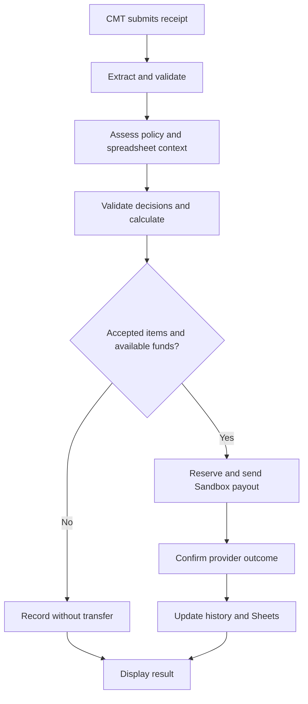

# Gantiin: Product Requirements Document

> Current design, PRD 2.3: Healthy-inspired pearl workspace, ink #292536, dusty rose #8A3E70, rose tint #F3E1EB, canvas #F5F5F8, mist #E9EDF7 and white surfaces. The owner explicitly granted palette freedom and chose flat controls. Historical 1.x glass, Waves and palette requirements below are superseded where they conflict. DESIGN.md and section 11 define the active interface.

| Attribute | Value |
|---|---|
| Version | 2.3 |
| Revised | 10 November 2026, Asia/Makassar |
| Previous baseline | Connected seven-job 1.9 backend/UI upgrade |
| Product owner | Gantiin project owner |
| Document language | English |
| Interface language | English |
| Release target | MVP for the PayPal AI Hackathon |
| Status | Owner requirements baseline. Proposals and unresolved decisions are identified. |

Revision 2.3 supersedes earlier verbose result/history requirements. Both regular and demo CMTs, and Treasurer readers, use the same concise components. Results show exactly Receipt total and confirmed Reimbursed; item rows show name, amount and status. Why rejected opens the actual reason in a soft native popup outside the table, without changing column widths, supporting Close/Escape/outside click and focus return. Accepted explanations, per-item arithmetic and technical snapshot panels are removed from the interface, preserving backend evidence. History retains search/sort/filter, one reimbursed amount and one status per record, with a total for filtered records. Select text is left aligned; the chevron is inset from the right. Mobile rows avoid repeated labels.

OCR and Decider instructions now explicitly separate transcription from eligibility, prohibit prompt-injection/role changes and invented evidence, and request concise item-specific reasons. A real standalone Gemini test on 10 November passed one supplied receipt (4 items, RM239.90, 3 accepted/1 rejected, RM200.00 eligible) after adapting the provider wire schema while keeping strict local validation. scripts/check-ai.mjs supports repeating that test without PayPal/Sheets via explicit usage opt-in. Main application flags and financial readiness remain unchanged; demo website results remain simulated and do not enter the main Treasurer journal. No general AI accuracy or actual payment acceptance is claimed.
| Implementation | Authorized 6 November. See [current status](../status.md) for actual evidence and limitations. Requirements describe intended behavior, not verified capabilities. |

Revision 2.2 adds one isolated Committee demo, not a second Treasurer. Committee login has Try demo below PayPal, requiring no credentials. Demo uses a separate persistent SQLite database, scoped session/cookie/CSRF token and same-origin API namespace, with simulated OCR/decisions/payments/ledger and no external service calls. Use sample and all four Campus Career Day receipt images support repeat testing. History and Account offer Reset demo with confirmation; it clears demo receipt BLOBs, claims, payment records and simulated funds, retains the demo account/session, and waits for pending simulated work before clearing. Regular accounts have no deletion/reset capability. Post-submission cancellation remains excluded. Demo is explicitly labeled Simulation and never acts as evidence of real Gemini/PayPal/Sheets acceptance.

Revision 2.2 also requires non-shifting event-save toasts, normal placeholders that disappear on focus without clearing saved data, centered History selectors in both roles and a compact selected-receipt panel with file actions below the image. Submit stays right on desktop and full-width on phones. Login retains the Healthy palette with restrained pearl/rose/mist background depth. Existing real financial, account and provider safeguards remain.

Revision 2.1 introduced the following behavior, retained in 2.2. Treasurer configures one active event using only name and description, with no manual rules/template/currency/ambiguity controls. The Decider uses that actual event context plus receipt/approved reference evidence and provides a visible, specific reason for every rejected item. OCR and Decider remain separate. Server-generated stable relevance guardrails and policy versioning retain validation and stale-assessment protection; existing records remain readable.

Overview adds a Treasurer-only Open spreadsheet action at top right, opening the configured Google document. The budget defaults to Google Sheets even while payment integrations are unconfigured: blank/unavailable Sheets means Unavailable, never default RM100 or fallback funds. Fixture payments cannot use the real read-only Google budget. Explanatory/synthetic paragraphs and the topbar search are removed; History's own search remains. Financial labels, status, rejection reasons, validation and errors stay. The owner selected Campus Career Day 2026 for demo artifacts, supplied under demo/campus-career-day; the package does not overwrite the saved runtime event or add spreadsheet funds. Both Gemini role slots are owner-selected gemini-3.5-flash-lite; API catalogue access is verified, inference/usage activation remains pending.

Documentation is consolidated under docs and generated reports under .cache/reports. Explicit owner authorization permits removal of proven-unused scaffolds, background assets and obsolete UI reports, preserving runtime data, credentials and active financial code. Current evidence: docs/verification/current.md. Earlier revision notes remain history where they conflict with 2.1.

Revision 2.0 implements the owner's complete Healthy-inspired frontend redesign. The owner granted palette freedom and chose flat controls. All role screens share the new pearl/rose system, connected to the completed seven-job backend. Overview adds actual activity/recent-claim projections; History refresh preserves ongoing input/focus. No financial rules, runtime records or external provider authorization change. The revision notes below document historical 1.x decisions. Current requirements: decisions D-19 onward and section 11; evidence: docs/frontend-redesign-2.0.md.

Revision 1.1 translates the complete baseline into English, records the owner's Vibrant Sunset palette and left navigation, and reconciles superseded documentation. During implementation the owner confirmed default rejection for insufficient context and absence of credentials/provider/cost authorization. Requirement IDs, priorities, acceptance criteria, business rules, and deferred scope are retained. Technical decisions belong in docs/engineering/decisions.md.

Revision 1.9 implements the owner's connected seven-job requirements in docs/engineering/implementation-plan.md. Use separate LangChain Gemini OCR/decider roles with one key and configurable shared/override model names, evidence-preserving extraction, complete cited item decisions, scoped net-cost allocation, immutable automatic authorization and retry-safe payment/item recording. Event settings offer a manually selected seminar draft, never an automatic event replacement. Result UI separates eligibility, confirmed payout and synchronization. The four Vibrant Sunset anchors/assets/light glass stay. Prior unsupported-tax/discount and provider-selection statements are superseded; real model accuracy, owner Sheets setup and MYR Sandbox acceptance remain unverified. See docs/verification-seven-jobs.md.

Revision 1.2 records the owner's role-first centered login, password-only shared Treasurer flow, preserved Committee email/password/PayPal flow, all-button glass override, and bounded light dashboard direction from the supplied references. Existing credentials/data, money and access safeguards remain unchanged.

Revision 1.3 supersedes the separate role-selection screen and bounded workspace. The owner requested a stable white login card with sliding Treasurer/Committee tabs, a quiet generated Vibrant Sunset background, a visible configuration-gated PayPal option, a full-viewport workspace, persistent navigation/sign out, and concise interface copy. Existing account credentials, role verification and financial behavior are preserved.

Revision 1.4 records the latest owner instructions: glass card, Welcome above tabs, internal placeholders, close field spacing, automatic height per role, no Treasurer ID row and no footer after PayPal. This supersedes equal card heights. Add commissioned logo, Remember me, local-demo immediate reset, Treasurer PayPal and Settings consolidation. Sidebar controls are unframed with fading active feedback, superseding glass there. Existing data and financial behavior remain intact.

Revision 1.5 supersedes conflicting visual/session requirements above. Follow the owner's supplied purple glass-button CSS reference; use white semi-transparent glass for login/sidebar and pill actions with subtle idle edges. Role choices and password eyes are frameless exceptions. Treasurer has no Remember; Committee remembers only the last successful email, never the password or session token. Overview replaces Budget, adds Welcome, Treasurer/person icon and removes Refresh budget/latest/references panels. Both sidebar history links become History, in a narrower 232px sidebar. Both histories support name/ID search and name/date/requested-amount sorting without totals panels. Receipt upload uses a full-width glass dashed area without a white outer panel and Submit/send icon. Recovery removes the G, introduction/footer/badge and uses an upper-left back arrow. Existing data, provider gates and financial safeguards remain.

## 1. Product overview

Revision 1.8 records owner-authorized QC using Anti Slop, Taste Skill and UI/UX Pro Max. Keep all four Vibrant Sunset anchors and the supplied purple reflective glass material. Refine Settings navigation and panel alignment, left-aligned mobile headings, responsive search/filter grids, content-sized status labels, labeled table records at narrow/tablet widths and a restrained Primary/Secondary blend on the available-balance card. Retain current assets, login/recovery spacing, accounts/data, provider configuration and reimbursement safeguards. See DESIGN.md and docs/ui-qc-1.8.md for decisions and evidence.

Revision 1.7 restores the last Vibrant Sunset palette, assets and every button style at the owner's explicit request. The dark theme and later button-wrapper redesign are rejected and removed. Current colors: Primary #4D3A4D, Secondary #BE5CA9, Tertiary #D59CC5, Background #EADADA; white data surfaces and readable plum text. The owner also removes the sidebar scrollbar; navigation remains usable by wheel/keyboard on short screens. All earlier functional requests remain, including email-only remembering and recovery spacing that increases toward its action. Docs 1.6 are historical experiments, not current instructions.

Gantiin helps event committees process reimbursements from receipt to payment. A committee member (CMT) uploads a receipt using their own account. AI reads the items, evaluates their relevance to the event, and accepts or rejects each item with a reason.

Assessment uses the treasurer-configured event description/policy, planned requirements/RAB, approved expense history and receipt evidence. No purchase-context field is requested from CMT. An unlisted item can still qualify when available evidence and policy establish relevance; a note/purpose is never fabricated. Insufficient evidence follows the configured rejection policy.

The application calculates eligible reimbursement, checks the remaining Google Sheets budget, and automatically pays from the treasurer's PayPal Sandbox account to the CMT's PayPal Sandbox account. If funds cover only part of the eligible amount, payment is capped at available funds. After confirmed success, the application records the transaction and updates the spreadsheet budget.

The hackathon MVP has no manual treasurer approval or AI override. The application validates data, recipient identity, amounts, funds, and provider results before authorizing payment or reporting success.

The event name/type has not been selected. Examples are illustrative and do not select the final event.

## 2. Problem and objectives

### 2.1 Problem

- Treasurers track event finances in spreadsheets and check funds before reimbursing purchases.
- Receipts mix event and personal purchases, requiring item-level reimbursement.
- Relevance checks, calculations, payments, and recording are tasks the owner wants AI/automation to assist with or perform.
- CMTs need accepted/rejected item results and the amount actually paid.

These problems come from the owner's concept. User validation, time savings, and accuracy have not been measured.

### 2.2 MVP objectives

1. Demonstrate a real flow from a synthetic receipt to confirmed PayPal Sandbox payout and Google Sheets update.
2. Produce binary item decisions with visible reasons and context sources.
3. Pay accepted items automatically without waiting for treasurer approval.
4. Enforce budgets, including partial payment and no payment when exhausted.
5. Separate treasurer access from each CMT's personal account.

### 2.3 Required evidence

- Mixed receipts match labeled test decisions and amounts.
- Correct Sandbox recipients receive the correct MYR amounts.
- Concurrent/repeated submissions do not reuse funds or pay the same claim twice.
- History, successful PayPal transactions, and spreadsheet records reconcile.

These are acceptance targets, not existing results.

## 3. Decisions and scope

### 3.1 Owner-confirmed decisions

| ID | Decision |
|---|---|
| D-01 | Two roles: treasurer and CMT. |
| D-02 | All treasurers use one shared demo account. |
| D-03 | Separate identity per CMT; two initial CMTs, with examples possibly using three. |
| D-04 | Treasurer creates additional CMT accounts. |
| D-05 | Event/reimbursement currency is Malaysian ringgit, MYR. |
| D-06 | Google Sheets supplies remaining budget; PayPal funds must support it. |
| D-07 | Automatically record successful payments and update remaining Sheets budget. |
| D-08 | Configure event description and rules through the website. |
| D-09 | AI uses labeled planned requirements/RAB and explicitly approved expense history. |
| D-10 | Unlisted items may be accepted when policy fits and justification is clear. |
| D-11 | AI accepts/rejects per item; no manual review queue or treasurer override. |
| D-12 | Only some items on a receipt may be reimbursed. |
| D-13 | Pay partially, capped at available funds, when budget is insufficient. |
| D-14 | Record unpaid differences in treasurer history; later handling is unresolved. |
| D-15 | Clearly readable synthetic receipts and PayPal Sandbox for demo. |
| D-16 | Login with PayPal is an additional feature for linked existing CMT and Treasurer identities. |
| D-17 | Discuss final financial reports/balance sheet after core features. |
| D-18 | English UI, centered role-first login, left navigation with text menu names. |
| D-19 | Flat controls with quiet borders, subtle hover and visible keyboard focus, following the owner's Healthy selection. Historical glass styling is superseded. |
| D-20 | Final demo event and Gemini model identifiers remain unselected. LangChain with Gemini is the selected implementation; identifiers and usage authorization remain explicit configuration. |
| D-21 | Owner granted palette freedom for Healthy redesign: ink #292536, dusty rose #8A3E70, rose tint #F3E1EB, pearl canvas #F5F5F8, mist #E9EDF7, white records. Replaces Vibrant Sunset. |
| D-22 | Owner confirmed during implementation: reject insufficient purchase context by default, with an explanation. Technical failures remain separate. |
| D-23 | Welcome above Treasurer/Committee choices in a centered white card of content-sized height. Flat sliding current-role surface, compact top spacing. Committee starts selected; Treasurer supplies Password only with no ID/email row or reserved space. Selection never grants a role. |
| D-24 | Centered entry composition, with return-to-role selection; no promotional side panel. |
| D-25 | Consistent flat actions throughout login, recovery and workspace. No glass, conic rim, sheen or glow. Password eyes remain icon-only with accessible targets. Opaque financial surfaces and a rose/mist metric hierarchy. |
| D-26 | Supplied dashboard interiors inform grouped summaries/records. Latest owner revision uses a full-viewport light workspace, fixed desktop sidebar, and sticky mobile header with sign out always available. No copied domain content or invented charts/statistics. |
| D-27 | Quiet CSS pearl/rose authentication backdrop. Retain original supplied art files but do not load the heavy Waves image in the active interface. No generated assets or third-party sign-in branding beyond configured PayPal. |
| D-28 | Replace verbose instructional paragraphs, repeated event/role/identity chrome and large fixture disclaimers with concise task labels. Owner removed login/sidebar/reset demo badges; Connections and actual transaction evidence identify simulation. Keep operational errors and form labels. |
| D-29 | Original Gantiin SVG logo at upper-left login/sidebar; no login footer after PayPal. Internal placeholders, accessible hidden labels, 12px field gap. No thick outer input-focus frame. |
| D-30 | No Remember option for Treasurer. Committee Remember email stores only the last successfully authenticated email, defaults enabled and supports clearing/opt-out. No app-stored password/token or UI-requested persistent session. Forgot password changes a local synthetic password, including A, only under existing loopback fixture gates; no public/Sandbox reset. |
| D-31 | Both roles use History then icon-labeled Settings. Fixed 232px cool-gray sidebar, clear idle navigation, white current destination, pinned Sign out. Sticky compact mobile header. No sidebar Demo badge. Settings contents remain role appropriate. |
| D-32 | Submit Receipt pairs a large file target with actual event/rules for context. No totals, preset picker or Purchase context field. Single-file drag/drop/Browse files, preview/removal/validation. Server accepts receipt-only submissions without inventing a note. No empty-history Submit CTA. |
| D-33 | Keep the owner's transparent Ribbon logo and original foreground unchanged, shared across all roles. No replacement logo or fabricated profile artwork. |
| D-34 | Original Waves files remain unmodified for history; PRD 2.0 removes their active authentication loading in favor of the quiet CSS backdrop. |
| D-35 | Overview has actual-role greeting/date, three financial summaries, real seven-day submission activity, current event, payment overview and recent claims. No Refresh budget or spreadsheet-reference dump. New summaries project backend data; no financial authority moves to the browser. |
| D-36 | Both histories remove totals panels and share name/ID search, date/name/requested-amount ascending/descending sorting and status filtering. Numeric MYR sen ordering, unknown values last. Preserve filters on refresh, reset across users; server ownership stays authoritative. |
| D-37 | Large flat upload target with rose dashed edge and no extra white outer frame. Real Browse files, preview/removal and dark flat Submit/send icon; clear hover, disabled and busy states. |
| D-38 | Recovery removes the in-card G, explanatory sentence, bottom back text and demo badge. Use an accessible 44px upper-left arrow to sign in, natural card height; retain configuration gates, errors and success feedback. |

### 3.2 P0: core

- Login and role access; shared treasurer, two initial CMTs, treasurer-created CMTs.
- Website configuration of versioned event context/policy.
- Google Sheets budget/reference reads and payment recording.
- Synthetic receipt upload/extraction and AI item decisions with reasons.
- Server money calculation, budget caps, partial and automatic Sandbox payouts.
- History, item results, payments, and synchronization status.
- Duplicate prevention, CMT isolation, integration failure recovery.
- Centered role-first login, compact left navigation and consistent Healthy-inspired flat controls.

### 3.3 P1: after core

- Official PayPal identity linking and Login with PayPal into existing CMT and shared Treasurer accounts.
- Discuss final financial report scope. Format/features are undefined and implementation remains deferred.

### 3.4 Outside MVP

- Real money or PayPal live.
- Manual reimbursement approval, AI override, or `needs_review` business decisions.
- Receipt authenticity certification or unproven fraud claims.
- Training from scratch; fine-tuning is not approved.
- Currency conversion and full multi-event management.
- Automatic future settlement when funds increase.
- Exports, general chatbot, external notifications, unspecified formal reports.

Proposed simplification: one active event and one connected spreadsheet. This does not select the event.

## 4. Users and access

| Capability | CMT | Treasurer | Automated system |
|---|---|---|---|
| Login | Own account | Shared account | Validate session |
| Create CMT | No | Yes | Store role/membership |
| Configure event/policy | No | Yes | Store versions |
| Upload receipt | For self | Not a core treasurer task | Validate file/owner |
| Read receipts/history | Own only | All event claims | Enforce access |
| Read event needs/policy | Joined event | Managed event | Retrieve context |
| Accept/reject | No | No | AI with output validation |
| Override AI | No | No | No manual override |
| Arbitrary new payout | No | No | Validated results/funds only |
| See unpaid difference | Own result | Full history detail | Calculate from transactions |

The shared account identifies an account, not the individual treasurer using it. Do not claim individual attribution.

## 5. User flows

### 5.1 Treasurer setup

1. Log in.
2. Enter event name/description and policy.
3. Connect Sheets and clearly identify budget, RAB, approved references.
4. Prepare and controllably link Sandbox sender/recipients.
5. Use initial CMTs or create additional accounts.

Google authentication and recipient verification are technical choices with documented setup. LLM output must never supply recipient identity.

### 5.2 CMT submission

1. Log into own website account.
2. Upload synthetic receipt by drag/drop or Browse files; no explanation field.
3. Extract items; retrieve event policy and relevant sheet references.
4. AI returns binary decisions, categories, reasons, context references.
5. Validate results, calculate amounts, read/reserve current funds.
6. Automatically send positive Sandbox payout when prerequisites hold.
7. Confirm provider success; record payment and update Sheets.
8. Show own results to CMT; all event claims/differences to treasurer.

Extraction, AI, spreadsheet, and payment failures have separate operational statuses. Diagram shows normal flow, not all recovery.

## 6. Functional requirements

| ID | Priority | Requirement and acceptance condition |
|---|---|---|
| FR-01 | P0 | Centered flat white login: Welcome, sliding tabs, compact placeholder fields, PayPal last. Content-sized height, same width. Treasurer Password only without ID row; Committee Email/Password. Both show disabled PayPal until configured. Preserve role/rate/origin/session protections, accessible labels and validation/loading/failure states. |
| FR-02 | P0 | Two initial CMT demo accounts. Treasurer-created accounts have unique IDs and correct membership. No public auto-registration. |
| FR-03 | P0 | Treasurer saves event title, description, explicit allowed/prohibited rules/categories and policy version. Optional seminar selection loads a draft only; explicit save changes existing settings. Assessments retain snapshots. |
| FR-04 | P0 | Read current MYR budget from Sheets; reject invalid formats/currencies. Browser values cannot authorize payouts. |
| FR-05 | P0 | Retrieve RAB and explicitly approved history; cite source type and original row/ID. |
| FR-06 | P0 | CMT uploads synthetic receipt tied to claimant/event; show extracted items. |
| FR-07 | P0 | Every assessed item has its unique ID, accepted/rejected, category, clear English reason, actual rule/reference IDs and policy version. Validate coverage/citations/versions before allocation; store both model identities and assessment time. |
| FR-08 | P0 | Unlisted items can be accepted on policy/context; missing match alone cannot reject. |
| FR-09 | P0 | Server totals accepted net item costs in integer MYR sen. Specific discounts stay with their items; explicitly scoped shared taxes/discounts use deterministic proportional largest-remainder allocation and exact printed-total reconciliation. Rejected items contribute zero. Unsupported/ambiguous charges are technical failures. |
| FR-10 | P0 | Pay min(eligible, available); zero budget sends no payout. |
| FR-11 | P0 | Automatic payout from configured Sandbox sender to verified recipient; no approval control. |
| FR-12 | P0 | Paid requires confirmed payout-item success, never batch creation/timeout. |
| FR-13 | P0 | One sheet transaction/budget deduction plus stable reimbursed-item records per confirmed payment despite retries. Separate eligible/paid/unpaid values; transaction records never become approved AI references automatically. |
| FR-14 | P0 | Treasurer sees claimant, requested/eligible/paid/difference, item reasons, provider IDs, sync state. |
| FR-15 | P0 | CMT sees only own claims/files/recipient/payments, including direct ID manipulation. |
| FR-16 | P0 | Clear recoverable operational failures, no duplicate payments or invented business rejection. |
| FR-17 | P1 | Existing CMT/Treasurer signs in directly through official PayPal authentication/consent. Match the verified payer ID to exactly one preassigned CMT recipient or configured Treasurer sender in the selected event/role; save the provider subject on first sign-in. No preliminary website login is required. Unknown/ambiguous IDs or subject conflicts gain no access; role selection cannot elevate access. Optional Settings linking remains. |
| FR-18 | P0 | Treasurer has no Remember checkbox. Committee remembers its last successful email only, with opt-out/clearing and graceful storage-unavailable behavior. Never store passwords/tokens in browser storage. Login and PayPal UI omit persistent-session preference and retain browser-session cookie/eight-hour server limit. Frameless eye/struck-eye visibility preserves values and accessible state. |
| FR-19 | Demo | Loopback fixture-only reset accepts new password/confirmation, including A, revokes sessions and rate limits resets. Reject in Sandbox/public-host configuration or when disabled. Normal creation/password change stays 12+ characters. No public recovery capability is claimed. |
| FR-20 | P0 UI | Overview and shared History behavior follow D-35/36, preserving actual money/outcome semantics and server ownership. Sidebar short labels and reduced width retain responsive navigation/sign out. |

Implemented upload contract: one PNG/JPEG up to 5 MiB, receipt-only form with no context field. Extract visible original descriptions, merchant/date/currency, quantities/unit/line values, item discounts, scoped shared adjustments/other charges and printed total without inventing unreadable data. Null absent units are preserved. Supported tax/discount allocation follows docs/engineering/net-cost.md; ambiguous/unsupported charges fail technically. Initial credentials and Google authentication are documented in local setup.

## 7. AI context and spreadsheet use

### 7.1 Sources

| Source | Role |
|---|---|
| Event description/policy | Purpose, categories, prohibitions, limits, conditions. |
| Planned requirements/RAB | Concrete explicitly identified event plans. |
| Approved expense history | Prior relevant expenses in the same event. |
| Receipt evidence | Items, quantities, prices and any purpose supported by receipt/event/approved references. Legacy stored CMT notes remain evidence; new form requests no note. |

Current explicit policy takes precedence. History/similarity cannot approve a prohibited purchase. Rejected expenses never enter approved references.

AI acceptance, payment, and reference approval are separate. Partially paid expenses cannot appear fully paid.

### 7.2 Output

Each result retains item ID, binary decision, category, reason, actual references, policy version. Store source snapshots/rows, assessment time, and model identity. New items may be accepted through policy/context. Never invent rules or sheet sources.

### 7.3 Uncertainty/failure

Business outcomes remain accepted/rejected. The owner confirmed rejection of insufficient purchase context by default, with a reason identifying the missing context. New event policies inherit this default; the final event's substantive rules still need configuration.

Timeout, invalid model output, and read failures are failed/pending processing, not `needs_review` or invented rejection. No payment until valid output; technical recovery adds no human approval.

### 7.4 Learning from Sheets

Use current explicitly approved planned/history rows as inference references, with deterministic relevant-row retrieval (up to 40) and snapshots, without changing model weights. Separate LangChain Gemini structured OCR/decider calls share a key. GEMINI_OCR_MODEL/GEMINI_DECIDER_MODEL fall back to GEMINI_MODEL; both must resolve and usage must be authorized. Actual identifiers, accuracy, quotas/costs and any future fine-tuning remain unverified/open. Current prohibitions override history, unexplained codes are not guessed, and no remaining-funds/recipient/payment tools are supplied to the decider.

Receipts, CMT context, and cells are data. Embedded instructions cannot change system policy, recipients, or payment authority.

## 8. Budget and payment rules

### 8.1 Amounts

| Symbol | Meaning |
|---|---|
| T | Actual printed receipt total, equal to validated net item costs including scoped adjustments. |
| E | Sum of validated accepted net item costs, never a model payment total. |
| B | Remaining sheet budget read for this allocation. |
| R | Reservations not reflected in Sheets, including successful unsynchronized payouts. |
| A | Allocatable: `max(0, B - R)`. |
| P | Planned payout: `min(E, A)`. |
| U | Eligible minus actually confirmed paid. |

Calculate on server in integer MYR sen; display e.g. RM30.00. Reject negatives, invalid amounts, different currency before payout.

### 8.2 Behavior

- E = 0: no payout; all items rejected.
- E > 0, A = 0: accepted items remain accepted; no payout due to exhausted budget.
- 0 < A < E: pay A, record unpaid difference.
- A >= E: pay E.
- Paid status/amount follow confirmed provider result, not P.

Differences are recorded only. No debt queue, settlement schedule, or automatic later transfer is defined.

### 8.3 Synthetic arithmetic

Real eligibility requires a selected event policy.

| Item | Amount | Example |
|---|---:|---|
| Policy-permitted printing | RM40.00 | Accepted |
| Permitted registration supplies | RM20.00 | Accepted |
| Prohibited personal purchase | RM35.00 | Rejected |

T = RM95.00; E = RM60.00. If A = RM30.00, P = RM30.00. On success, record paid RM30.00 and difference RM30.00. Accepted items do not become rejected.

### 8.4 Funds, concurrency, recovery

Sheets supplies budget, not PayPal balance. Prepare Sandbox sender funds for budget and fees. Fee treatment is unresolved; never silently deduct fees from CMT reimbursement.

Serialize allocations or reserve atomically. Proposed priority: successful allocation order, without model reordering.

Hold reservations while provider outcomes are uncertain. Release on definitive failure. On success plus failed Sheets write, record sync_pending, protect funds, retry synchronization idempotently. Never send another payout to fix recording.

Restrict/reconcile manual edits to system budget ranges so they cannot overwrite in-flight transactions.

## 9. Status and history

| Layer | Required states/behavior |
|---|---|
| Item | Accepted/rejected with reason/context. |
| Processing | Received, processing, assessed, failed. |
| Payment | Not sent, processing, awaiting confirmation, succeeded, failed, skipped zero. |
| Coverage | Full/partial/none based on eligible and confirmed paid. |
| Sheets | Not required, pending, synchronized, failed awaiting retry. |

Retain claimant, receipt, time, items/reasons/categories, policy version, references, requested/eligible/planned/confirmed amounts, difference, MYR, provider IDs, sync status.

Treasurer must see unpaid differences. CMT sees own results and payment; further difference labeling was open in baseline.

## 10. Integrations and data

### 10.1 Google Sheets

The API reads, updates, and appends. Design for standard quotas; verify current service terms before enabling usage. AI/hosting costs are separate. [Values API](https://developers.google.com/workspace/sheets/api/guides/values), [limits](https://developers.google.com/workspace/sheets/api/limits).

Baseline proposed mapping, finalized in implementation setup:

| Tab/area | Minimum contents |
|---|---|
| Event Budget | Event ID, MYR, initial/adjustment funding, remaining funds, revision/time. |
| Planned Items | ID/row, description, category, purpose, explicit approval, policy reference. |
| Approved History | Item/claim ID, description/category/context, accepted status, policy version, eligible and paid separately. |
| Transactions | Unique payment ID, claim, CMT, confirmed amount, MYR, confirmation time, PayPal ID, sync information. |
| Reimbursed Items | Stable payment:item identity, original/net costs, scoped adjustments, eligible/paid/unpaid values, policy/rule/reference evidence; accounting only, never automatically approved references. |

Reference and financial history may share a view but retain different meanings. Only explicitly approved rows enter references. Do not store auth data in Sheets. Durable application storage is required for accounts/files/claims/reservations/payments/recovery; baseline technology was open.

### 10.2 PayPal Sandbox

Payouts sends treasurer-to-CMT payments. Demonstrate actual provider processing, not UI numbers. [Payouts API](https://developer.paypal.com/api/payouts).

MYR payouts are documented between Malaysian users. Proposed Sandbox configuration: Malaysia sender/recipients, funded MYR, no conversion. Account availability must be tested before claiming integration complete. [Supported features](https://developer.paypal.com/payouts/supported-features/).

Persist stable payment IDs before submission. Use endpoint-supported idempotency and payout-item reconciliation to prevent duplicate transfers. [Idempotency](https://developer.paypal.com/api/rest/reference/idempotency/).

Login with PayPal uses official identity authorization and user consent, with Sandbox test accounts. AI receives no password or broader access. [Login](https://developer.paypal.com/log-in/build), [Sandbox](https://developer.paypal.com/sandbox-testing/overview/).

### 10.3 Minimum entities

- Account: identity, role, status, membership.
- Event/Policy: description, MYR, versioned rules, sheet connection.
- Recipient: verified CMT-bound Sandbox identity.
- Receipt/Claim: file, claimant, context, items, revision.
- Assessment: decisions, reasons, categories, references, policy/model versions.
- Reservation: amount, claim, state, budget linkage.
- Payment: stable identity, recipient, amount, provider/reconciliation state.
- Sync/Audit: unique transaction, sync state, important changes.

These describe required information, not a mandatory framework/schema.

## 11. Interface and interaction

### 11.1 Current direction, 2.0

- English Healthy-inspired task workspace, pearl canvas, cool gray navigation, dusty rose accent and opaque records. The owner explicitly granted palette freedom and selected flat controls on 8 November.
- Centered white login with Welcome above Treasurer-left/Committee-right tabs, compact placeholders with accessible names and automatic form height. Password-only Treasurer and email/password Committee. Plain eye controls, remembered email only, PayPal last. No heavy backdrop image.
- Fixed 232px desktop sidebar, white selected destination and clear idle links. History then Settings, pinned Sign out. Compact sticky mobile header and keyboard-operable menu. Settings tabs share flat states.
- Owner-supplied transparent Ribbon logo remains unchanged. Flat 10px actions, 12px fields, 16px panels, 24px authentication card and 6px status labels. Subtle metric tint gradients, no blur/conic sheen/glow or continuous motion.

### 11.2 Screens

CMT tasks prioritize submission and personal results. Treasurer tasks prioritize budget, history, members, and policy. No approval screen.

Use the entire viewport for the light workspace, removing the large outer rounded frame and margins. On desktop, the sidebar remains fixed at viewport height with scrollable navigation if necessary and sign out pinned at the bottom. On phones, a sticky compact header keeps Menu and Sign out visible even when navigation is closed. Main content scrolls normally. Group actual financial summaries with records and preserve opaque receipts/tables.

Login/recovery use a quiet CSS pearl/rose backdrop and centered opaque card. Both roles show PayPal instead of Google/Apple, disabled with an accessible explanation until configured. No footer after PayPal. Committee Remember email supports opt-out; Treasurer has no checkbox. App-rendered passwords start empty. Recovery keeps its upper-left accessible back arrow and fixture-only backend gate. Original Waves files remain unmodified but are not loaded.

Remove repetitive welcome/purpose paragraphs, role-selection descriptions, repeated event/role/sidebar identity text, the redundant top strip, and the How decisions work panel. Overview has the requested concise Welcome, Treasurer role cue. Keep meaningful form labels, errors, live payment status, user-entered policy/context, and actual simulation identification in Connections/transaction evidence. Simulation is not represented as real provider activity.

CMT main labels: Submit Receipt, History. Treasurer: Overview, History. Both have Settings; Treasurer sections are Account, Event Policy, Committee Members and Connections; CMT sees Account only. Overview leads with available/eligible/confirmed-paid summaries, actual seven-day activity and recent claims alongside current event/payment context. Only backend-confirmed money is shown as paid. Histories retain search/six sort orders/status filters, with refresh preserving the current query/focus even during slow or failed requests. Large upload target and actual event/rules form two desktop columns, stacking on phones. No preset or purchase-context input. Results retain net costs, source evidence, model/version snapshots and distinct assessment/payment/sync recovery. Empty/loading/error states remain.

### 11.3 Current pearl and rose palette

| Role | Color | Purpose |
|---|---|---|
| Ink / primary | #292536 | Figures, headings, primary actions. |
| Dusty rose | #8A3E70 | Links, focus and selected evidence. |
| Rose tint | #F3E1EB | Available-funds summary. |
| Background | #F5F5F8 | Pearl canvas. |
| Mist | #E9EDF7 | Assessed eligibility summary. |
| Sidebar | #F0F1F6 | Cool navigation/supporting areas. |
| Surface | #FFFFFF | Opaque financial records/forms. |
| Muted | #686575 | Supporting text. |

Selected under the owner's explicit palette freedom. Verify text AA and non-text control/chart contrast across actual states. Supporting semantics and exact component tokens are in the design-system master.

Dials: ENERGY 2 / RHYTHM 2 / MOTION 1. Warm palette and monetary focal points establish identity; predictable rows and task-specific composition support scanning. Record tokens/reasons in DESIGN.md and design-system/gantiin/MASTER.md before screen implementation.

Use 150-200 ms edge/background/elevation hover feedback without exaggerated movement or layout shift. Visible focus, active/disabled states, touch controls, reduced motion. Opaque readable receipts/tables.

## 12. Nonfunctional requirements

| ID | Requirement |
|---|---|
| NFR-01 | Server verifies session, role, event membership, ownership. |
| NFR-02 | CMT data isolated even through direct IDs/file URLs. |
| NFR-03 | Google/PayPal/AI credentials server-only, outside Git; no payment secrets in browser/model. |
| NFR-04 | Application validates money, recipient, snapshot; untrusted text cannot choose endpoint/role. |
| NFR-05 | Repeated clicks, refresh, timeout, concurrency, notifications never duplicate spending/recording. |
| NFR-06 | Payment/sync survives restart; uncertain outcomes remain reconcilable. |
| NFR-07 | Keyboard, visible focus, labels, contrast, textual statuses. |
| NFR-08 | Desktop/mobile without clipped text or inaccessible actions. |
| NFR-09 | Labeled synthetic demo; no unmeasured accuracy/security/savings claims. |
| NFR-10 | Clear progress; latency/AI limits set after provider selection/testing. |

## 13. Acceptance scenarios

Record actual evidence separately; expected behavior uses synthetic fixtures and explicit policy.

| ID | Scenario | Expected |
|---|---|---|
| AC-01 | Treasurer and two CMT logins | Correct role views and personal history. |
| AC-02 | A requests B's claim/receipt | Server denies access. |
| AC-03 | Treasurer creates CMT | Unique account logs in, correct membership. |
| AC-04 | Planned item/policy references | Actual traceable source citations. |
| AC-05 | Unlisted item fits policy | Accepted with policy justification. |
| AC-06 | Old history contradicts current ban | Current prohibition wins. |
| AC-07 | RM40 + RM20 accepted, RM35 rejected; enough funds | Eligible/confirmed payout RM60, exclude RM35. |
| AC-08 | Same receipt, RM30 funds | Paid RM30; unpaid RM30 in history. |
| AC-09 | Eligible, zero funds | No payout; exhaustion explained. |
| AC-10 | All rejected | No payout; reasons per item. |
| AC-11 | Two RM40 claims, RM50 budget | Total paid <= RM50; defined allocation order. |
| AC-12 | Repeat operation | At most one payment. |
| AC-13 | Identical paid receipt resubmitted | Prevent duplicate fixture payout; no general fraud claim. |
| AC-14 | Provider accepted, unknown outcome | Await confirmation, never prematurely paid. |
| AC-15 | Paid, then Sheets write fails | No second payout; pending sync; retry records once. |
| AC-16 | Sheets pre-allocation read fails | No stale-budget payout. |
| AC-17 | AI timeout/invalid output | Operational failure, no payout/fabricated rejection. |
| AC-18 | Mouse/keyboard login/nav | Text menus, focus/active states, subtle hover, working controls. |
| AC-19 | P1 configured | Linked CMT login; unknown identity gains no membership. |
| AC-20 | Choose/switch roles, use shared Treasurer password-only form and Committee email/password form | Correct visible fields; Change role clears credentials/errors; required hidden fields never block Treasurer; loading/invalid-password/service-failure states remain clear. |
| AC-21 | Send Treasurer identity to Committee endpoint, alter role/user fields, or use a distinct Committee password at Treasurer endpoint | No Treasurer session; authorization still derives from the validated database account, retaining origin/session/rate-limit protections. |
| AC-22 | Inspect flat controls across login/workspace on desktop/mobile/short keyboard viewport | Consistent flat states, readable contrast, keyboard focus and reduced motion. Role tabs support arrows/Home/End, card width stays stable with content-sized heights, and Sign out remains visible after scrolling with mobile menu closed. |
| AC-23 | Apply UI/auth revision to existing database | Existing account IDs/password hashes and financial records remain intact; no reseed/reset/migration required. |
| AC-24 | Successful/failed Committee sign-ins, logout/reload, switch accounts, opt out, block storage, Treasurer login | Only the last successful Committee email is stored/prefilled, password/token absent from browser storage, no Treasurer checkbox or UI session extension, authentication works when storage is unavailable. |
| AC-25 | Search/sort/filter both histories and refresh or change user | Name/ID match, numeric/date/name ordering in both directions, unknown amounts last, filters survive refresh and reset by user; Committee receives only own records. No totals summary. |
| AC-26 | Browse/drop/remove/submit receipt; open reset and use back arrow | Large rose-dashed flat upload, real picker/validation/preview, Submit icon survives feedback; event context stays readable at narrow widths. Recovery arrow navigates, gated reset/error/success unchanged. |
| AC-27 | RM80 accepted goods plus RM20 rejected goods, shared RM10 discount | Printed total RM90, eligible net RM72; exact item allocations sum to the printed total. |
| AC-28 | Shared and role-specific Gemini model configuration, absent credentials, malformed/truncated response | Explicit resolved role models and shared key; no silent default/fallback or payout on technical failure. |
| AC-29 | Confirmed payout with missing/failed item recording | One payment and deduction; stable item identities/rows recover without another payout or approved-reference promotion. |
| AC-30 | Load seminar draft, inspect stored event, then explicitly save | Existing event unchanged on load; new version only on Save policy version. |

P0 complete means judges can run two-CMT flow, inspect AI items, witness real confirmed Sandbox payout, inspect Sheets updates. Static fixtures/mockups alone do not satisfy this.

## 14. Proposed sequence

| Stage | Target |
|---|---|
| M0: demo contract | Select event/policy, sheet, fixtures, provider/model, fee strategy; prove MYR Sandbox. |
| M1: foundation | Login, CMTs, access, event setup, Sheets, durable claims/recipients. |
| M2: assessment | Extraction, references, decisions, sen arithmetic, reservations. |
| M3: payments | Automatic payout, reconciliation, partials, history, recoverable sync. |
| M4: verification | Scenarios, desktop/mobile, setup, end-to-end demo. |
| M5: extras | PayPal login after core; report scope discussed separately. |

No implied deadlines or successful results.

## 15. Open decisions

| ID | Decision and disposition | Needed |
|---|---|---|
| O-01 | Final event/policy/categories/fixtures. Convocation not selected. Test policy remains labeled synthetic. | Real assessment/demo. |
| O-02 | LangChain/Gemini roles implemented. Actual model identifiers, accuracy, costs/quotas and usage authorization remain unverified. | Explicit configuration and later authorized trial. |
| O-03 | Framework/database/storage/auth/hosting. Routine local choices now authorized, record ADR; paid hosting needs approval. | Implementation. |
| O-04 | Further difference display/treatment; no automatic settlement. | After core. |
| O-05 | Final financial report scope/format. | Deferred for owner. |
| O-06 | Palette resolved D-21; left text navigation confirmed; document detailed/mobile layout. | Screens. |
| O-07 | Sheet mapping/auth/protection/budget changes. Select/document contract. | Integration. |
| O-08 | Fees, supporting balance, fee records. Never silently reduce reimbursement. | Sandbox trial. |
| O-09 | PNG/JPEG <=5 MiB and receipt-only form. Scoped tax/discount allocation implemented; unsupported other charges, ambiguous scopes/bases and irreconcilable totals remain technical failures. | docs/engineering/net-cost.md and executable fixtures. |
| O-10 | Ambiguous-context default resolved by D-22: reject with explanation. Allocation order is the durable claim/reservation order documented in ADR-010. | Final event rules still need configuration. |
| O-11 | P0 recipient verification/credential distribution. Controlled setup, never model identity. | Accounts/payments. |

Deferred decisions must not be filled as owner-approved assumptions. Record later revisions/ADRs.

## 16. Older documents

This PRD records the 5 November baseline and 6 November implementation/design instructions. Superseded template provisions are reconciled:

| Old | Current |
|---|---|
| Manual treasurer approval/ADR-002 | AI binary decisions, application authorization, automatic payout, no override. |
| USD | MYR. |
| needs_review | Accepted/rejected; separate operational errors. |
| Deferred Sheets writes | Read/write P0. |
| MVP reports/CSV | Report deferred; CSV unconfirmed. |
| No visual direction/teal proposal | Vibrant Sunset, simple login, left text menus, glass, subtle hover. |

Retain server arithmetic, account/event isolation, verified recipients, duplicate prevention, confirmed provider success. Automatic authorization binds a validated snapshot rather than removed human approval.

## 17. References

Structure covers goals/users/scope/flows/requirements/assumptions/acceptance and distinguishes technical choices. [Atlassian PRD guide](https://www.atlassian.com/agile/product-management/requirements/).

Sources: owner conversations, AGENTS.md, README.md, PROJECT_STATUS.md, docs/product/mvp.md, docs/product/brief.md, docs/policies/reimbursement.md, docs/security/access-control.md, docs/engineering/decisions.md, docs/engineering/payments.md.

Use current official hackathon requirements for submission, including meaningful PayPal/AI and a runnable prototype. [Hackathon](https://paypalaihackathon.devpost.com/).

API references document service behavior, not proof Gantiin integrations ran.
